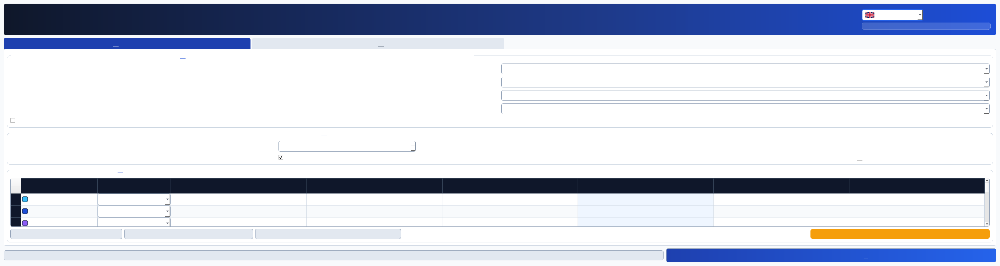

# Academic Methodology & Operational Guide: `mpyy_donati_analiz` (v2.0.0)

* **Plugin Name:** MPYY Urban Facility Accessibility & Optimization (`mpyy_donati_analiz`)
* **Version:** `2.0.0` (QGIS 3.x & 4.x Compatible, `supportsQt6=True`, `qgisMaximumVersion=4.99`)
* **Default UI Language:** English (`en`), with instant runtime selector for Turkish (`tr`), Chinese (`zh`), and Spanish (`es`)
* **Standard Projected CRS:** `EPSG:5253` (TUREF / TM30)
* **Author:** Baran Adsuna (`https://github.com/baranadsuna`)

---

## 1. Urban Planning Problem Statement

In statutory urban planning under the Turkish Spatial Plans Construction Regulation (*Mekânsal Planlar Yapım Yönetmeliği — MPYY Annex-2*), planners must evaluate whether residential blocks have adequate pedestrian access to public facilities (primary/middle/high schools, family health centers, hospitals, places of worship, parks, and social-cultural centers) and allocate vacant urban parcels (*boş imar adaları*) to resolve deficits.

Relying solely on Euclidean (*as-the-crow-flies*) buffers overestimates accessibility whenever railway tracks, streams, highways, or cul-de-sacs sever pedestrian routes. Conversely, allocating an entire large vacant urban block ($> 15,000\text{ m}^2$) to a single facility wastes scarce urban land. `mpyy_donati_analiz` solves both problems simultaneously via a custom road-graph shortest-path engine ([`mpyy_engine.py`](../src/mpyy_donati_analiz/mpyy_engine.py)) and a 12-step recursive binary parcel splitter ([`mpyy_dialog.py`](../src/mpyy_donati_analiz/mpyy_dialog.py)).

---

## 2. Mathematical Formulation & Algorithmic Architecture

### 2.1 Prepared Road Graph & $O(1)$ Spatial Index Snapping (`FastRoadGraph`)
Given a road centerline vector layer $\mathcal{L}_{\text{net}}$ transformed to the working metric CRS (`EPSG:5253`), `FastRoadGraph` constructs a compressed undirected graph $G = (V, E, w)$:
* **Topological Vertex Coalescing:** Endpoints and intermediate polyline vertices (sampled only when accumulated segment length $\ell_{\text{acc}} \ge 15.0\text{ m}$ to prevent graph bloat) are snapped within tolerance $\tau = 2.5\text{ m}$ using a 9-neighbor spatial grid hash $(g_x, g_y) = (\lfloor x/\tau \rceil, \lfloor y/\tau \rceil)$.
* **$O(1)$ Cached Nearest-Node Snapping (`snap_point_to_node`):** All graph vertices are indexed in a C++ R-tree (`QgsSpatialIndex`) paired with a coordinate hash cache `(round(x, 1), round(y, 1))`:

$$(v^*(p),\, d_{\text{snap}}(p)) = \arg\min_{v \in V} \|p - \mathbf{x}_v\|_2$$

### 2.2 Multi-Source Dijkstra Shortest-Path Catchments (`FastRoadGraph.multi_source_dijkstra`)
Grounded in **Dijkstra (1959)** ([DOI: `10.1007/BF01386390`](https://doi.org/10.1007/BF01386390)), rather than executing separate single-source searches from every residential block, `multi_source_dijkstra` seeds the binary min-heap (`heapq`) with all existing facility centroids $\mathcal{F}_k$ of category $k$ simultaneously:

$$D_k(u) = \min_{f \in \mathcal{F}_k} \left( d_{\text{snap}}(f) + \min_{\pi: v^*(f) \leadsto u} \sum_{e \in \pi} w(e) \right), \qquad \forall u \in V \text{ with } D_k(u) \le D_{\max}$$

For each residential block $r_i$ with polygon area $A_i$ and area-weighted population $P_i = P_{\text{total}} \frac{A_i}{\sum_{j} A_j}$, the plugin evaluates both Euclidean distance $d_{\text{euclid}}(r_i, k)$ and network distance $d_{\text{road}}(r_i, k) = D_k(v^*(r_i)) + d_{\text{snap}}(r_i)$:
1. **`OK`:** $d_{\text{euclid}}(r_i, k) \le R_{\text{euclid},k}$ and $d_{\text{road}}(r_i, k) \le R_{\text{net},k}$.
2. **`BIRD OK / NO ROAD ACCESS` (Barrier Diagnostic):** $d_{\text{euclid}}(r_i, k) \le R_{\text{euclid},k}$ but $d_{\text{road}}(r_i, k) > R_{\text{net},k}$.
3. **`NO ACCESS`:** Both thresholds exceeded; $P_i$ is added to the unserved demand pool $P_{\text{unserved}}(k)$.

### 2.3 Two-Step Capacity Deficit & Graph-Median Facility Allocation
Synthesizing the capacity-to-demand principles of **Luo & Wang (2003)** ([DOI: `10.1068/b29120`](https://doi.org/10.1068/b29120)) and the network median location problem of **Hakimi (1964)** ([DOI: `10.1287/opre.12.3.450`](https://doi.org/10.1287/opre.12.3.450)), the effective population deficit for facility type $k$ is:

$$D_{\text{pop}}(k) = \max\!\left(P_{\text{unserved}}(k),\; \max\!\left(0,\; P_{\text{total}} - \sum_{f \in \mathcal{F}_k} C_{\text{unit},k}\right)\right)$$

For each vacant urban block $v$ with centroid $p_v$ and area $A_v$, a local shortest-path tree $D_v(\cdot)$ is computed up to $2600\text{ m}$. Each candidate facility category $k$ satisfying $A_v \ge A_{\min,k}$ and minimum spacing $d_{\text{same}}(v, k) \ge 0.65\,R_{\text{net},k}$ is scored by:

$$\text{Score}(v, k) = \frac{2.2 \cdot P_{\text{newly\_covered}}(v, k) + 0.6 \cdot D_{\text{pop}}(k)}{1.0 + 0.45 \cdot N_{\text{allocated}}(k)}$$

where $P_{\text{newly\_covered}}(v, k)$ is the sum of previously unserved residential block populations reachable within $D_v(v^*(r_i)) + d_{\text{snap}}(r_i) \le R_{\text{net},k}$.

### 2.4 12-Step Recursive Binary Polygon Subdivision (`split_polygon_by_ratios`)
When the highest-scoring facility $k_1$ requires target parcel area $A_{\text{target},1} = \max(A_{\min,k_1}, \min(0.5\,A_v, A_{\max,k_1}))$ and leaves remaining area $A_{\text{rem}} = A_v - A_{\text{target},1} \ge A_{\min,\text{park}}$, `split_polygon_by_ratios` divides polygon $G_v$ into 2 or 3 contiguous sub-polygons (`[k_1, park]` or `[k_1, k_2, park]`):
* At each step, the bounding box $[x_{\min}, x_{\max}] \times [y_{\min}, y_{\max}]$ is bisected orthogonal to its longer axis ($\Delta x \ge \Delta y \implies x\text{-axis}$, else $y\text{-axis}$).
* A 12-step binary search adjusts the clipping half-plane $H(\text{mid})$ until $\text{Area}(G_{\text{rem}} \cap H(\text{mid}))$ matches the target area fraction within $2^{-12} \approx 0.0244\%$ precision.

---

## 3. Real PyQGIS GUI Workflow

| Stage | Screenshot Asset | Operational Description |
| :--- | :--- | :--- |
| **Stage 1: English Default Table & Layer Configuration** |  | The dialog opens in English (`en`) by default with a 4-language selector (`en`, `tr`, `zh`, `es`). Users select the Prepared Network, Existing Residential Blocks, and Vacant Parcels (or click **Generate Sample Polygon Data** in `EPSG:5253`) and customize the editable MPYY Annex-2 standards matrix. |
| **Stage 2: Detailed Accessibility & Subdivision Report** |  | After clicking **RUN SMART ANNEX-2 ANALYSIS & RENDER ON MAP**, the plugin generates categorized vector layers (`MPYY_Onerilen_ve_Bolunen_Donati_Alanlari`) and switches to Tab 2 displaying Euclidean vs. Network deficits and parcel-by-parcel subdivision narratives. |

---

## 4. Verified Academic References (Crossref Validated)

1. **Dijkstra, E. W. (1959).** *A note on two problems in connexion with graphs*. Numerische Mathematik, 1(1), 269–271. **DOI:** [`10.1007/BF01386390`](https://doi.org/10.1007/BF01386390)
2. **Luo, W., & Wang, F. (2003).** *Measures of Spatial Accessibility to Health Care in a GIS Environment: Synthesis and a Case Study in the Chicago Region*. Environment and Planning B: Planning and Design, 30(6), 865–884. **DOI:** [`10.1068/b29120`](https://doi.org/10.1068/b29120)
3. **Hakimi, S. L. (1964).** *Optimum Locations of Switching Centers and the Absolute Centers and Medians of a Graph*. Operations Research, 12(3), 450–459. **DOI:** [`10.1287/opre.12.3.450`](https://doi.org/10.1287/opre.12.3.450)
